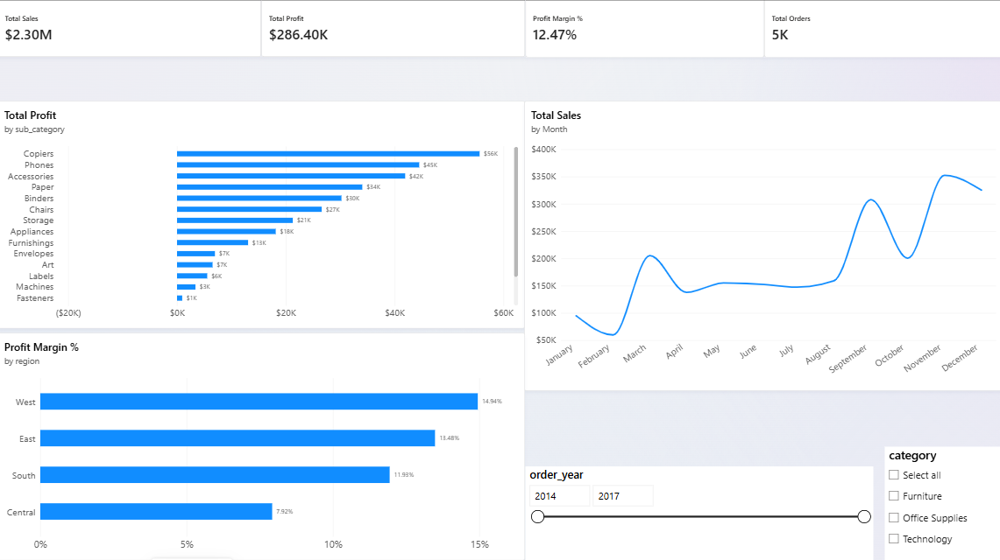
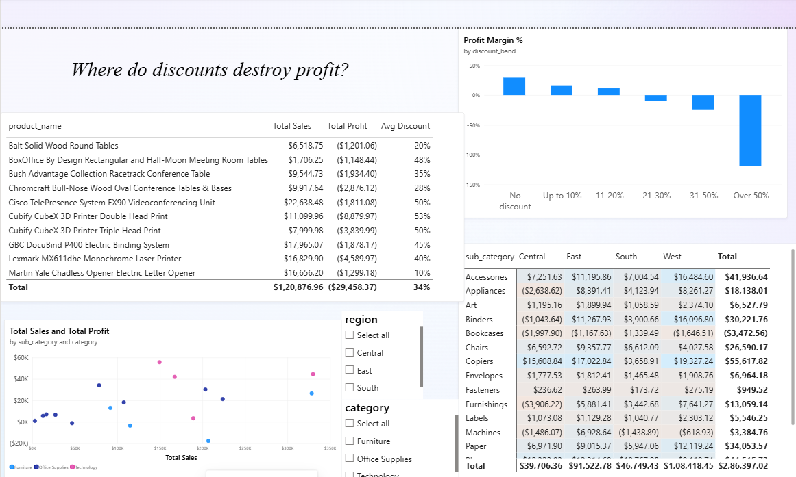
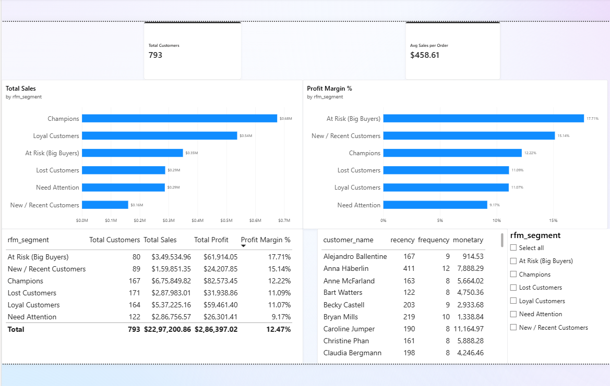

# Why Are Some High-Selling Products Losing Money?
### Superstore Sales & Profitability Analysis (SQL + Python + Power BI)

## Business problem
A retail company has strong sales, but profit is uneven. This project finds
where money is made or lost, and recommends what to change.

## Dataset
Superstore Sales dataset (Kaggle): 9,994 orders from 2014 to 2017, covering
products, customers, regions, discounts, sales and profit.

## Tools
- **MySQL Workbench:** data cleaning and aggregation
- **Python (pandas, matplotlib, seaborn):** cleaning, exploration, RFM analysis
- **Power BI:** 3-page interactive dashboard

## Key findings
- Tables, Bookcases and Supplies lose money overall.
- Orders with a 21-30% discount have a margin of about -10%.
- Central is the weakest region (7.99% margin); Furnishings in Central
  lost $3,906.22.
- Three products (two Cubify Cubex 3D printers, Double and Triple Head Print and Lexmark MX611dhe Laser Printer) lost about $17,300 combined.
- Sales peak in November, December and September each year; margins in those months are lower.
- Champions drive the most sales ($675,849.82); 80 big-spending customers
  are "At Risk".

## Recommendations
1. Cap discounts at 20%, starting with Tables, Bookcases and Supplies.
2. Review pricing and discounts in the Central region.
3. Review or stop selling the three worst products.
4. Run a win-back campaign for the 80 At Risk customers.
5. Set margin limits on year-end promotions.

Full write-up: [Insights report](report/insights_report.md)

## Dashboard

To use the interactive version, download
[dashboard/superstore_dashboard.pbix](dashboard/superstore_dashboard.pbix)
and open it in Power BI Desktop.

## Repository structure
- `data/` raw, cleaned and RFM CSV files
- `sql/` SQL queries (cleaning, sales and profit, discounts, trends, top and bottom lists)
- `notebooks/` Python notebook (cleaning, charts, RFM segmentation)
- `dashboard/` Power BI file and PDF export
- `report/` insights report and chart images

## How to reproduce
1. Load `data/superstore.csv` into MySQL and run the files in `sql/` in order.
2. Run `notebooks/superstore_analysis.ipynb` (needs pandas, numpy,
   matplotlib, seaborn).
3. Open `dashboard/superstore_dashboard.pbix` in Power BI Desktop.

## Limitations
The data covers 2014-2017 only, and has no cost, returns or marketing-spend
data. The analysis shows that discounts and losses go together, but does not
prove discounts alone caused the losses.

## About me
Aditya Wadaskar, aspiring data analyst. aditya-wadaskar-431212230/ 
